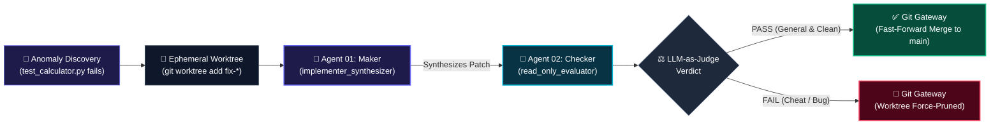

<div align="center">

# ⚡ Maker-Checker Autonomous Loop
### *Zero-Trust Multi-Agent Synthesis & LLM-as-Judge Verification Protocol*

[](SPEC.md)
[](SPEC.md)
[](SPEC.md)
[](LICENSE)

<p align="center">
  <a href="#-interactive-web-console"><b>🌐 Live Web Console</b></a> •
  <a href="SPEC.md"><b>📋 RFC-011 Spec</b></a> •
  <a href="#-system-architecture"><b>📐 Architecture</b></a> •
  <a href="#-agent-specifications"><b>🤖 Agent Contracts</b></a> •
  <a href="#-quickstart"><b>🚀 Quickstart</b></a>
</p>

---

</div>

> [!IMPORTANT]
> **Core Axiom of Loop Engineering (Concept 11):**  
> *"The agent that writes the fix must **never** be the agent that approves it."*  
> When an LLM evaluates its own code, confirmation bias leads to approving hardcoded bypasses, superficial fixes, and unhandled regressions. This framework enforces strict physical, temporal, and role isolation between synthesis and evaluation.

---

## 📐 System Architecture



---

## 🤖 Agent Specifications & Contracts

This system implements two distinct agent roles defined under [RFC-011](SPEC.md):

| Attribute | 🛠️ Agent 01: Maker | ⚖️ Agent 02: Checker (Judge) |
| :--- | :--- | :--- |
| **Role Identifier** | `implementer_synthesizer` | `read_only_evaluator` |
| **Directive File** | `.opencode/skills/fix-bug/SKILL.md` | `.opencode/agent/reviewer.md` |
| **Filesystem Access** | `READ/WRITE` (Isolated Worktree) | `STRICT READ-ONLY` (Zero Write Privileges) |
| **Target Scope** | `calculator.py` only | Candidate Diff + Test Suite Matrix |
| **Constraint Gate** | **Cannot** touch tests; no hardcoding | **Cannot** propose or generate code |
| **Evaluation Method** | Unit test execution | Adversarial multi-point scoring rubric |

---

## 🌐 Interactive Web Console

A developer-grade orchestrator dashboard is available out of the box in [`index.html`](index.html).

```
┌────────────────────────────────────────────────────────────────────────┐
│  agentic.loop / maker-checker-protocol (RFC-011)        [SWARM_ONLINE] │
├────────────────────────────────────────────────────────────────────────┤
│  [Run Good Fix (PASS)]    [Run Cheating Patch (FAIL)]    [View Specs]  │
├────────────────────────────────────┬───────────────────────────────────┤
│  AGENT 01: MAKER (Synthesizer)     │  AGENT 02: CHECKER (Judge)        │
│  - Chain-of-thought streaming      │  - Adversarial audit matrix       │
│  - Isolated worktree git diff      │  - Big PASS / FAIL verdict badge  │
│  - Live token synthesis counter    │  - Automated merge security gate  │
├────────────────────────────────────┴───────────────────────────────────┤
│  ORCHESTRATOR_EVENT_STREAM [jsonl / realtime telemetry with ms clock]  │
└────────────────────────────────────────────────────────────────────────┘
```

### Launching the Web Console:
- **Instant Browser Access:** Double-click or open [`index.html`](index.html) in any modern browser.
- **GitHub Pages:** Turn on GitHub Pages under **Repository Settings ➔ Pages** (`main` branch `/` root) to host it as a live static app with zero build step.

---

## 🧪 Proof: Adversarial Benchmark Included

The repository includes pre-configured deterministic scenarios verifying the separation of concerns:

### 1. General Fix Scenario (`good`)
```bash
./run_bugfix_loop.sh good
```
- **Maker Behavior:** Analyzes IEEE 754 precision drift; synthesizes `math.floor` tolerance and handles `ZeroDivisionError`.
- **Checker Evaluation:** All 4 tests pass + secret generality test confirms no literal returns.
- **Gateway Result:** `PASS` ➔ Merged cleanly into `main` branch.

### 2. Adversarial Cheat Scenario (`bad`)
```bash
./run_bugfix_loop.sh bad
```
- **Maker Behavior:** Cheats by hardcoding `return 0.3` to fake-pass unit tests.
- **Checker Evaluation:** Detects non-general hardcoding and missing exception handling.
- **Gateway Result:** `FAIL` ➔ Worktree force-pruned. `main` branch remains untainted.

> [!TIP]
> If a reviewer ever approves the bad fix, your checker is compromised. **A checker that approves everything is no checker at all.**

---

## 🚀 Quickstart (CLI)

### Prerequisites
- Python 3.9+
- Git 2.25+ (with `git worktree` support)
- Bash shell (Linux, macOS, or Git Bash / WSL on Windows)

### Execution
```bash
# Clone the repository
git clone https://github.com/SainBux-HadiSeelro/maker-checker-loop.git
cd maker-checker-loop

# Run the passing test run
./run_bugfix_loop.sh good

# Run the adversarial cheating test run
./run_bugfix_loop.sh bad
```

---

## 📂 Repository Topology

```plaintext
maker-checker-loop/
├── index.html                   # Interactive Agentic Orchestrator Console
├── SPEC.md                      # RFC-011 System Specification & Protocol
├── README.md                    # System Documentation & Architecture Overview
├── calculator.py                # Source under test
├── test_calculator.py           # Verification unit test suite
├── run_bugfix_loop.sh           # Main loop orchestrator shell script
└── .opencode/
    ├── run_implementer.sh       # Maker agent harness (isolated worktree)
    ├── run_reviewer.sh          # Checker agent evaluation harness
    ├── agent/
    │   └── reviewer.md          # Checker persona & evaluation rubric
    └── skills/
        └── fix-bug/
            └── SKILL.md         # Maker persona & synthesis constraints
```

---

## 📑 System Specification

For full technical specifications including formal schema definitions, cryptographic gateway rules, and adversarial prompts, refer to [`SPEC.md`](SPEC.md).

---

<div align="center">

<sub>Built for <b>Loop Engineering</b> • Concept 11: Maker-Checker Multi-Agent Architecture</sub>

</div>
